# Yggdrasil Mobile

[Yggdrasil](https://github.com/SebbeJohansson/yggdrasil), rebuilt as an
Android app that runs only on the phone. No server, no PC.

The model runs on the phone too: Gemma 4 through
[LiteRT-LM](https://github.com/google-ai-edge/LiteRT-LM). Claude can be
added as a second option, through Claude Code running on the phone
([docs/claude-bridge.md](docs/claude-bridge.md)).

## Look

The same HUD as [my-widget](https://github.com/SebbeJohansson/my-widget),
the desktop Yggdrasil's dashboard (`ui/`):

- **Ground:** near-black, with the dot grid and its rolling wave, rising
  specks, and a horizon glow in the colour of the time of day (`Backdrop`).
  When something new needs you, the next wave passes amber.
- **Colour:** cyan for what is normal, amber for what wants you.
- **Panels:** corner brackets, turning amber when they warn.
- **Fonts:** Rajdhani for headings and numbers, JetBrains Mono for labels,
  Inter for reading. All are bundled; their licences are in `docs/licenses`.
- **Top bar:** the arc reactor (`ArcReactor`), one segment per part. Tap it
  for System → Phone. The ⚙ beside it opens Settings.
- **Tabs:** Ask · Inbox (Alerts and Messages) · Code · System (Phone, Jobs,
  Huginn, Tree, Runes), with Apps first when Ygg is the home screen.
- **Settings:** one page, as the dashboard's: Assistant (model, Claude,
  memory), Connection (Machines on the tailnet, Mímir), Notifications (permission, quiet hours,
  meetings), Boot sequence, Home screen, Updates, and Developer (test buttons).

  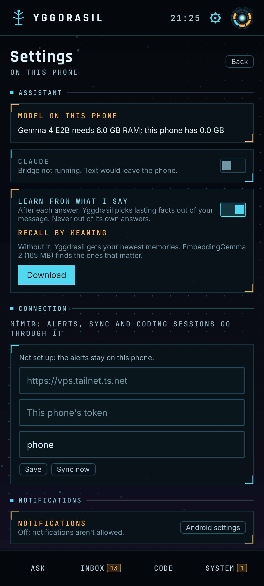
- **Chat:** the Ask tab reads like the dashboard's ask panel, and the
  assistant speaks as Yggdrasil (Norn is the part behind it). Your lines are
  cyan after `›`. Its lines sit under its name, with a line down the left.
- **Alerts:** the alert list keeps its severity line and its Seen, Snooze 1h,
  1d and Mute buttons.

| Ask | Alerts | Messages | Phone | Jobs | Huginn |
| --- | --- | --- | --- | --- | --- |
| 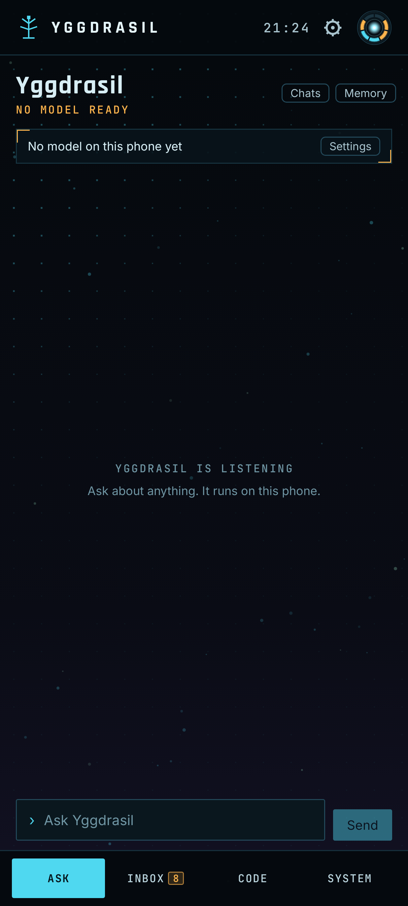 |  | 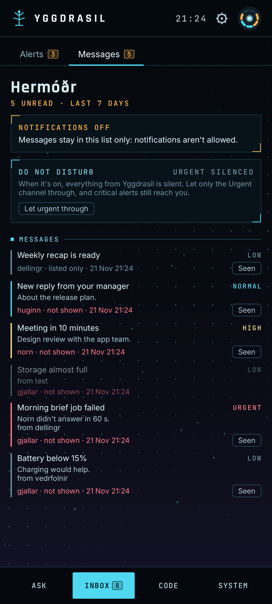 |  | 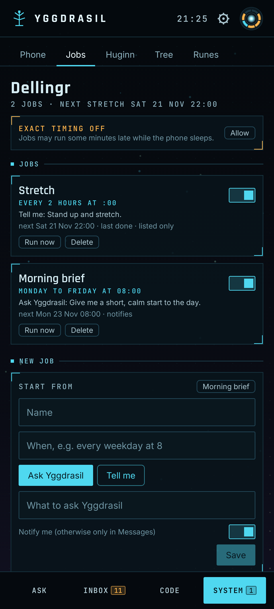 | 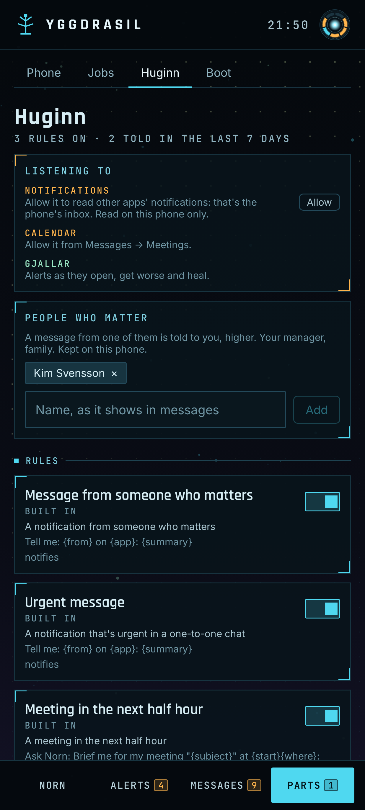 |

**Bifröst at night**, as on the desktop: after the working day (09:00–17:00,
Monday to Friday), when the app has gone 20 s untouched (5 min during
work hours), the ground fades into a slow aurora. It doesn't come while
you're typing or Yggdrasil is writing, and any touch sends it away. Today's
alerts and the troubled parts make it stormier: a calm day is slow and
green, a stormy one restless and violet. It's never red and shows no
numbers. When Android's animations are off it stands still.

| Calm | Stormy |
| --- | --- |
|  |  |

**The boot sequence**, as on the desktop (`boot/`):

- **Once a day:** the first open shows a heads-up display that waits for a
  tap. It brings the parts online line by line, then the outside (network,
  calendar access, notifications), then the phone, and gives a verdict.
- **Voice:** a calm voice says how it went. Only a voice installed on the
  phone is used, never a network one; with none installed there's no voice.
- **Ending it:** any tap ends it, and *Skip it for today* skips it.
- **Other opens:** the quick check, the same in about a second. It's
  see-through and lets every touch through.
- **From a notification:** you get at most the quick one.
- **Settings:** under Settings → Boot sequence (daily boot, voice, quick
  check, Run it now).

| Waiting for a tap | Systems check |
| --- | --- |
| 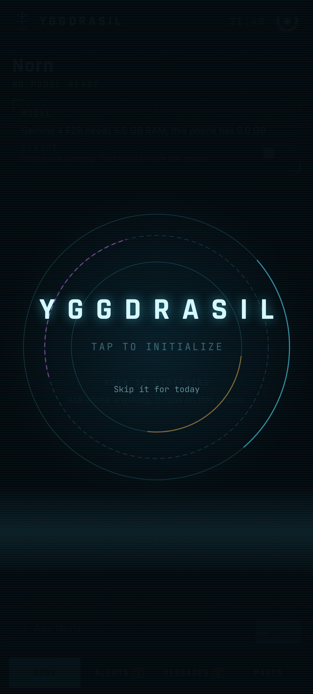 | 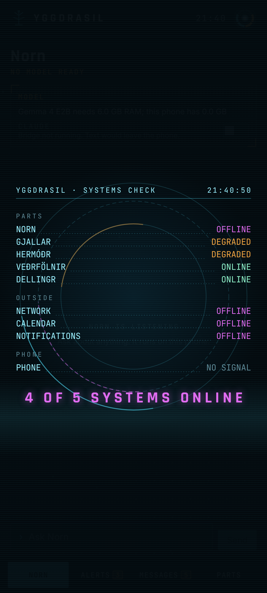 |

`ScreenshotTest` and `AuroraScreenshotTest` draw these on the JVM (Robolectric) into
`app/build/screenshots/`.

## Parts

The parts keep their Yggdrasil names and jobs. On the phone they are
packages in one app, not processes talking HTTP.

| Part | On the phone | Status |
| --- | --- | --- |
| **Norn** | chat, memory, the front desk | chat with Gemma 4, saved chats, memory |
| **Gjallar** | alerts from every part, in one place | working |
| **Hermóðr** | every message to you, as Android notifications | working |
| **Dellingr** | runs the jobs you put on a clock | working |
| **Huginn** | reacts to what just happened: messages, meetings, alerts | working |
| **Veðrfölnir** | the phone itself: battery, storage, memory, heat | working |
| **Sága** | keeps the phone's alerts and the desktop's in step, through Mímir | working (alerts) |
| **Ratatoskr** | the watchdog: is each part up, do its loops run; and your own rhythm | working |
| **Munin** | does what the phone depends on answer: Mímir, GitHub, Hugging Face, Anthropic | working |
| **Heimdall** | the security watchman: the repo's findings (a GitHub Action) and the phone's own | working |
| **Loki** | tests the watchers: blind spots, and tricks to see who notices | working |

Sindri is a desktop job; the phone starts and answers Claude Code sessions of
its own instead (the Code tab).

## The watchers: Ratatoskr, Munin, Heimdall, Loki

Ported from the desktop's, and on **System → Watchers**. What they find goes
to Gjallar; they fix nothing.

- **Ratatoskr's watchdog:** `down:<part>` (critical) when a part can't do
  its job, `stalled:` and `failing:<part>:<loop>` (warning) for its loops, a
  check down after two looks in a row and up after two. When its own round
  comes late (Android held Ygg back), Gjallar raises `silent:ratatoskr`.
- **Munin:** `down:<name>` when Mímir, GitHub, Hugging Face or (with the
  bridge) Anthropic don't answer, and `incident:` from GitHub's and
  Anthropic's status pages. Offline, the internet's checks wait and nothing
  is raised.
- **Heimdall:** a GitHub Action (`.github/workflows/heimdall.yml`) checks
  the repo nightly (vulnerable dependencies with OSV, keys in commits with
  gitleaks, the app's settings) into one issue labelled `heimdall`; the app
  reads it and adds the phone's own: USB debugging, an old security patch,
  no screen lock, the Claude bridge answering beyond the phone, and its key
  files' permissions. Findings that matter raise `<check>:summary`.
- **Loki:** blind spots, and strikes: a part reads as down, or one of its
  loops fails, for 1 to 10 minutes; Loki checks whether Ratatoskr and Gjallar
  notice, and raises `missed:<part>:<kind>` when they don't. Every trick ends
  on time. It leaves Gjallar and Ratatoskr alone on the phone.

## Alerts and messages

A part raises a problem with Gjallar, and tells you something through
Hermóðr. Both keep their state in `ygg.db` (SQLite).

**Gjallar** (`gjallar/`), with the same rules as Yggdrasil:

- The same source and key updates the open alert. A resolved alert opens
  again. An acknowledged one opens again when its severity goes up.
- How loud: `info` is listed in the app only. `warning` gets a quiet
  notification when it opens. `critical` gets an urgent one, again at most
  every 15 minutes while it keeps being raised.
- Muted alerts are listed, never pushed. Snoozed ones aren't pushed until
  the snooze ends (at most 30 days).
- Acknowledging, snoozing or resolving takes the notification back.
- Resolved alerts are kept for 30 days.

**Hermóðr** (`hermodr/`):

- There's one notification channel per priority (low, normal, high,
  urgent), so you set sound and Do Not Disturb for each in Android's
  settings.
- Quiet hours (default 22:00–07:00) hold everything but urgent messages.
  WorkManager sends what was held when they end.
- `hold` also waits while you're in a meeting. Meetings come from the
  phone's own calendars (`READ_CALENDAR`, asked for under Settings → Notifications,
  and read on the phone only). A meeting is timed, shown as busy, and not
  declined. Meetings less than 5 minutes apart count as one. Without
  calendar access nothing is ever held for a meeting.
- `push = false` lists a message in the app only.
- When notifications are off, the message is kept with the reason, and the
  Inbox → Messages says why.
- Messages are kept for 7 days.
- **Do Not Disturb:** Android silences Yggdrasil too. Inbox → Messages says
  whether the Urgent channel gets through, and *Let urgent through* opens
  Android's settings for that channel, where only you can switch on
  "Override Do Not Disturb". Critical alerts and urgent messages then still
  reach you, and the rest stay quiet.

Notification buttons: **Seen** on messages, **Acknowledge** and **Snooze 1 h**
on alerts. Settings → Developer has test buttons that run the whole path on
the phone.

## Syncing with the desktop: `saga/`

Sága keeps the phone's alerts and the desktop's in step through
[Mímir](https://github.com/SebbeJohansson/mimir), a small event log on your
VPS, reached over Tailscale. The desktop runs the same part (`ygg saga`).
Either side can be off: what the other sent waits in Mímir until it starts.
What each event means is in Mímir's `docs/events.md`.

- **The phone's alerts** go to Mímir each time something about one changes
  (opened, seen, snoozed, muted, resolved), not each time it is raised again.
  On the desktop they show in Gjallar as source `phone`, and are never pushed
  there: the phone already told you.
- **The desktop's alerts** are listed in Inbox → Alerts under *Desktop*, and
  never pushed here. **Seen**, **Snooze** and **Mute** on one ask the desktop
  to do the same. The alert shows it at once; the desktop's answer settles it.
- **What the desktop asks of the phone's alerts**, Sága does here, and takes
  the notification back.
- Every event waits in an outbox in `ygg.db` until Mímir has it.

It syncs a couple of seconds after an alert changes, when the app comes to
the front, and every 15 minutes with Veðrfölnir's check while it is closed.

Set up under Settings → Connection: the URL (`https://<vps>.<tailnet>.ts.net`,
HTTPS only: Android refuses plain HTTP) and this phone's token, both printed
by Mímir's `deploy/install.sh`. Keep the name `phone` unless you gave the token
another one. The phone needs Tailscale on.

Or skip the typing: on the desktop, ask for a pairing code (`ygg pair`: a QR code in the
terminal) and tap **Scan QR** under Connection, or copy
the `yggdrasil://pair?…` link and tap **Paste code**. Either fills the URL and token and saves them (a work
machine's code is refused). The scan screen is Google's (Play services), so the
app asks for no camera permission.

**Machines reached directly.** Under Settings → Connection → **Machines**,
add each of your machines on the tailnet (the VPS, the home PC) with its
tailnet name (`vps.<tailnet>.ts.net`) and its owner token
(`~/.config/yggdrasil/owner.token` there). The Code tab then reads its coding
sessions straight from its Sindri every 5 seconds ("live · over the
tailnet"), and **Send**, a dialog's choices, **Resume there** and the cloud
buttons are done on it at once, with no Mímir between and no
`SAGA_DRIVE_FROM` to set: its token is the say-so. A machine reached this way
shows once, live, instead of as it last sent through Mímir; one that doesn't
answer is named at the top with why, and its Mímir copy shows again. The
machine publishes its parts with Yggdrasil's `scripts/tailscale-serve.sh`
(Yggdrasil's docs/tailscale.md).

Each machine's other parts are asked the same way, each on its own port:

- **Alerts:** Inbox → Alerts lists each machine's open alerts from its own
  Gjallar ("live · over the tailnet"), read every 15 seconds while the tab
  shows; **Seen**, **Snooze** and **Mute** are done there at once. The
  phone's own alerts, which Sága sends there, are left out. A machine whose
  Gjallar doesn't answer shows its Mímir copy instead.
- **Parts and version:** its Ratatoskr says which parts are up, and its
  `/health` which Yggdrasil it runs. Settings → Machines and the Code tab say
  "v0.2.0 · 5 of 5 parts up", name a part that is down, and when a newer
  Yggdrasil release is out (GitHub, asked at most every 6 hours) give the
  `ygg upgrade` to run there; a machine built from a checkout says "from
  source".
- **Reading a session:** **Read** on a Claude Code session of a machine
  reached directly opens its transcript: your prompts, its replies, its
  thinking, and each tool call with what came back, following along every 3
  seconds (only what changed is sent again). Read only; the same reader opens
  a goal's agents.
- **Goals:** under its sessions, each machine reached directly lists its goals
  in play, in the order to act on them (needs you, moving, ready to review,
  drafts), with what each needs next. **Start** starts a draft that names its
  projects, **Resume** retries one waiting on Claude usage, **Read** opens one
  of its agents, and **New goal** makes a draft in up to 4 of its projects.
  Reviewing, races and merging stay on the desktop.
- **The assistant:** Settings → Assistant → **Answered by** picks who
  answers the Ask tab: this phone, or a machine whose Norn is up, as the
  desktop dashboard's "Assistant: <machine>" picker. With a machine chosen,
  each message goes to its Norn (`POST /v1/ask`) and is answered there with
  its own models, memory and inbox; the session is this chat's, so the
  conversation goes on there, and the chat is kept in the phone's Chats too.
  Nothing is learned on the phone from it. The Ask tab's line says
  "answered by <machine>'s Norn". A work machine is never offered or asked. A machine whose `/health` says it is a work
machine is never read or driven from the phone, and the tailnet's policy
keeps the phone from reaching it in the first place.

**Coding sessions (the Code tab).** Each machine that runs Sindri and Sága
(the desktop, another laptop) sends its coding sessions through Mímir
(`sindri.sessions`). The Code page lists them per machine with when each
was last heard from, Claude's last words and any permission prompt or
dialog waiting. From there:

- **Send** types a prompt into a session in a herdr pane on that machine,
  and a dialog's choices answer it.
- **Resume there** starts a session outside herdr again in a herdr pane.
- **Open in Claude** opens a session with Remote Control on, or a cloud
  session, in the Claude app.
- **Cloud sessions** the machine's Sindri started can be followed up and
  brought home there, and a new one started in one of its projects.

Each of these is a request (`sindri.session.*`, `sindri.cloud.*`) that only
that machine carries out, when it is on, within 30 minutes, and only if its
`SAGA_DRIVE_FROM` names this phone; the page says "Look only" otherwise.
Its answer shows under the session.

## The phone: `vedrfolnir/`

Veðrfölnir watches the phone as the desktop part watches the machine. One
problem is one alert with Gjallar (source `vedrfolnir`), and the alert
resolves by itself when its check passes again. It fixes nothing.

| Check | Warning | Critical |
| --- | --- | --- |
| `battery-low` | 15% or less and not charging | 5% |
| `storage` | 90% full | 95% |
| `heat` | Android's thermal status is severe, or the battery is 45 °C or more | Android's thermal status is critical |

It checks when the app starts, and every 15 minutes through WorkManager,
which is Android's shortest period. System → Phone shows the readouts live,
every 5 s while it's open, and has a segment on the arc reactor. A reading
the phone doesn't give, such as a battery level, raises nothing.

## Memory and chats: `norn/`

Norn remembers you, under the desktop's rules (`Memory.kt`, ported from
`norn/memory.go` with its tests):

- **Learning:** after each answer, Norn picks lasting facts out of *your*
  message, never its own answer. A small model states things confidently
  that aren't true, and a fact taken from its answer would come back as
  something you said.
- **The names guard:** a fact naming someone your message didn't mention
  is dropped. A small model copies the worked example otherwise.
- **No duplicates:** a fact already known, by wording or by meaning, isn't
  stored twice.
- **Recall:** the facts that bear on a question go in front of it, in the
  chat and in Dellingr's and Huginn's questions to Norn. In the chat they
  sit in front of your message, not in the system prompt, so the model's
  open conversation survives.
- **Finding the right facts:** by meaning with EmbeddingGemma 2 (165 MB,
  on the CPU, downloaded from the Memory page), by newest without it.
- **Learning runs on the side:** in a conversation of its own, so it
  doesn't close the chat's.
- **The Memory page:** see, add and forget facts, and switch learning off.

Chats are kept on the phone. **Chats** lists them and **New** starts one.
A reopened chat gives the model exactly what it had before, memories
included.

| Memory | Chats | A reopened chat |
| --- | --- | --- |
| 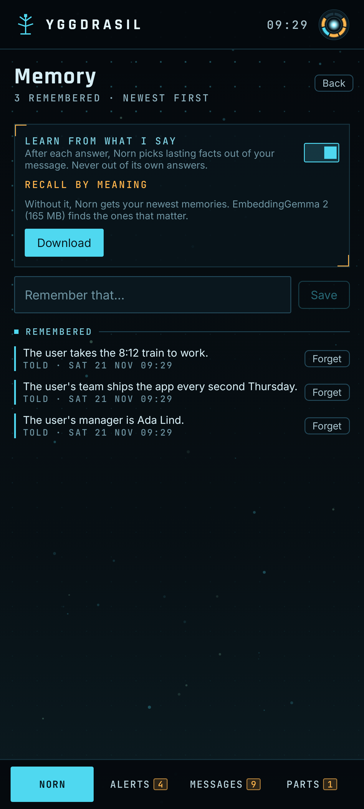 |  |  |

## Jobs: `dellingr/`

Dellingr runs the jobs you put on a clock (System → Jobs), under the desktop
part's rules:

- **When:** said in words, turned into cron once when you save, and shown
  back before you save. It understands "every weekday at 8", "every monday
  and friday at 9:30", "the 1st of each month at 10", "every 15 minutes", or
  cron itself (`Cron.kt`, ported from `cron.go` with its tests).
- **What:** *Tell me* sends your text. *Ask Yggdrasil* sends its answer.
  It answers on the phone, and it knows the date and today's meetings
  when it may read the calendar. The desktop's *goal* jobs need Sindri,
  so there are none.
- **Delivery:** through Hermóðr with hold, so a job's message waits out
  quiet hours and meetings. It's a notification, or only listed in Messages.
- **Missed runs:** a run the phone slept through runs once on waking, never
  once per missed tick. A job still running is skipped, not run twice at
  once.
- **Failures:** 3 in a row raise `failing:<id>` (warning) with Gjallar. It
  resolves when the job works again. Runs are kept for 30 days.
- **Timing:** an alarm wakes the phone for the next run. It's exact once you
  allow exact alarms (Android asks from Android 14); otherwise Android may
  move it by some minutes. Veðrfölnir's 15-minute check also ticks
  Dellingr, so nothing waits longer than that. Alarms are set again after a
  restart.

## Reactions: `huginn/`

Huginn reacts to what just happened (System → Huginn), under the desktop
part's rules. A rule is a trigger (an event and its filters) and an
action: *Tell me* (a text with `{fields}` filled in) or *Ask Yggdrasil*. It's
delivered through Hermóðr, with hold when it should wait out a meeting.

| Event | From | Fields |
| --- | --- | --- |
| `notification.arrived` | other apps' notifications, the phone's inbox (`HuginnListener`, once you allow notification access) | `{from} {app} {summary} {text}` |
| `calendar.soon`, `calendar.ended` | the phone's calendars: starting within 30 minutes, or ended in the last 20 | `{subject} {start} {end} {where} {notes}` |
| `alert.opened`, `alert.escalated`, `alert.resolved` | Gjallar, muted alerts left out | `{title} {detail} {severity} {source}` |

The built-in rules can be switched off, but never changed or removed:

- **Message from someone who matters:** "People who matter" is the phone's
  stand-in for the desktop's manager-or-above, a list of names you keep.
  Told with high priority.
- **Urgent message:** a one-to-one message that says urgent, ASAP,
  emergency, akut or brådskande. Told with urgent priority.
- **Meeting in the next half hour:** Norn writes a brief from the invite.
  It waits out the meeting you're in.

As on the desktop:

- An event more than an hour old is skipped.
- When two rules would tell you the same event the same way, only the
  first one does.
- Reactions are listed for 7 days.

Notification text is read and matched on the phone. Only what a rule sends
is kept, and the app's own notifications are never read. The calendar is
looked at on start and with Veðrfölnir's 15-minute check, so a brief comes
15 to 30 minutes before the meeting.

## World tree and runestones: `history/`

Ported from the desktop's Tree and Runes pages (`tree.ts`, `futhark.ts`,
`runestones.ts`). Both live under System → Tree and System → Runes.

**The tree** grows from what happened:

- **Branch:** a fact Norn came to remember.
- **Scar:** an alert that healed.
- **Raven:** a time Huginn told you something.
- **Leaves:** follow the seasons of your weeks. A busy week is summer, a
  quiet one turns to autumn.
- **Time:** drag the slider back through it, or tap *Grow* to watch it
  grow from the first day. Tap a branch, scar or raven to see what it was.

**Runestones** are carved for moments worth keeping:

- the first memory, then 100 and 1000
- a busy day
- the first raven, then 100
- a long storm that passed
- a quiet week

Each stone says it in English, written in Elder Futhark and drawn stroke
by stroke. Tap a stone for the plain words and the day.

The history is an append-only `history` table, so a forgotten memory or
a pruned alert stays in the tree. On first start the app fills it from
the memories, healed alerts and reactions you already have.

| Tree | Runes |
| --- | --- |
| 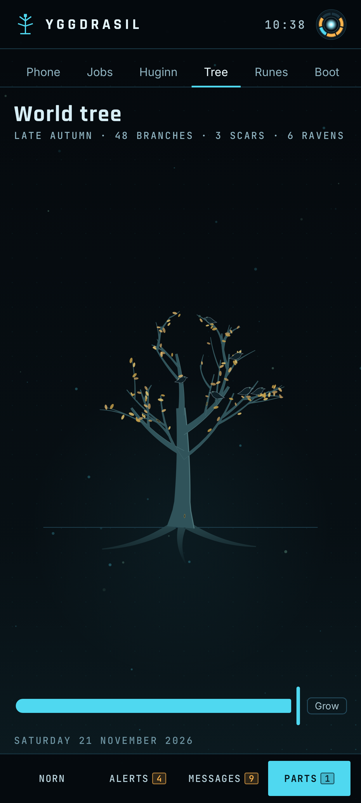 | 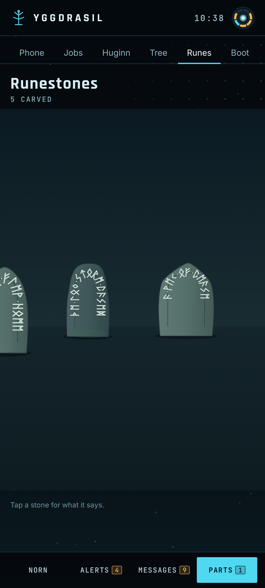 |

## Home screen: `home/`

Ygg can be the phone's home screen, so pressing Home brings you to Ygg. It's
optional: nothing changes until you choose it.

- **Turning it on:** Settings → Home screen → *Use Ygg as home screen*, or
  Android's Settings → Apps → Default apps → Home app. Switch back the same
  way.
- **Apps tab:** your pinned apps on top, then every app A-Z under its
  letter.
  - **Search:** type to find an app. It matches the start of the name or of
    a word, the initials ("gm" finds Google Maps) and accents. Enter opens
    the first match.
  - **Long-press:** pin, move, App info, Uninstall.
  - **Work apps:** apps in a work profile are listed too, marked *work*.
- **Home and Back:** Home always comes back to the apps and clears the
  search. Back goes to the apps and never leaves Ygg.
- **Light on the phone:**
  - **Boot:** as the home screen Ygg shows the daily boot only, never the
    quick check.
  - **Gemma:** the model still loads on your first question, never on Home.
- **One APK:** the home screen is a second entry point to the same app, a
  few kilobytes. Opening Ygg from its icon still works as before.

| Apps | Search |
| --- | --- |
| 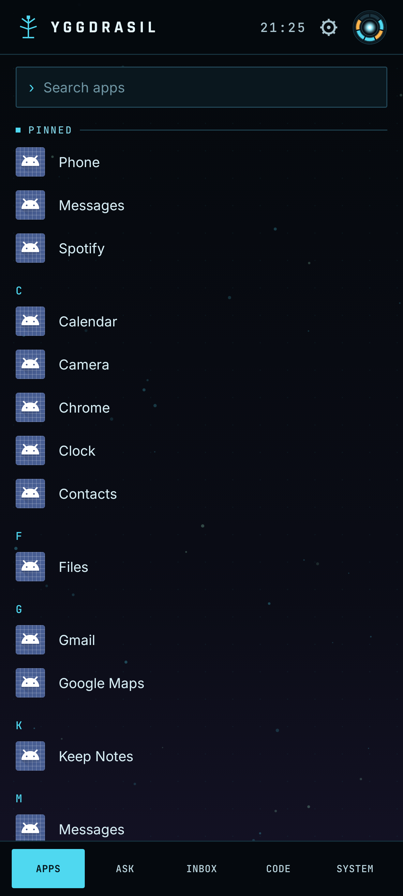 | 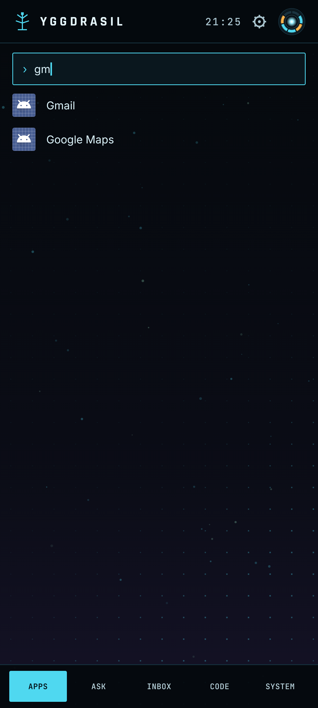 |

## Updates: `update/`

Release builds keep themselves up to date from this repo's GitHub releases.

- **Checking:** every 6 hours on any network, and when the app starts if
  it's been longer.
- **Safety checks:** a newer APK is downloaded, checked against its
  `.sha256` file and against this install's signing key, then installed.
- **Installing automatically** (on by default): Android 12+ lets an app
  update itself without asking, once you've allowed Ygg to install apps.
  - **When:** only when the screen is off or the phone is idle, and never
    while a model downloads.
  - **Turned off:** Hermóðr tells you once that the update is ready, and
    you install it under Settings → Updates.
- **Settings:** Settings → Updates shows your version and the
  newest one. It has *Check now*, *Download*, *Install now* and the
  automatic switch.
- **After an update:** Messages says what you came from, and Dellingr's
  alarms are set again.
- **Private repo:** GitHub only shows a private repo's releases with a
  token. Make a fine-grained token on github.com (Settings → Developer
  settings → Fine-grained tokens):
  - **Repository access:** only `yggdrasil-mobile`
  - **Permissions:** Contents, read-only

  Paste it under Settings → Updates → GitHub token. It's encrypted
  with a key in the phone's Android Keystore, and only sent to
  `api.github.com`, never to the storage host downloads redirect to.
  When it expires, Updates says so; make a new one.
- **Dev builds** never update themselves.
- **Play Protect:** if it blocks the update, install it by hand once (see
  `docs/releasing.md`).

## Focus: `hermodr/Focus.kt`

Ported from the desktop's `hermodr/focus.go` and the dashboard's focus
button, offer and recap.

- **Starting a focus:**
  - **Top bar:** tap the ring and pick 25 min, 50 min, 90 min or *until
    before your next meeting*. Each length ends 5 minutes before your next
    meeting if that comes first.
  - **Today card:** when a free stretch is worth it (30 min or more),
    Today offers *Focus until* the next meeting.
  - **Quick Settings:** add the *Focus* tile. It focuses for 50 min, and
    tapping it again ends the focus.
- **While it runs:**
  - Only urgent messages reach you; everything else waits.
  - A violet strip under the top bar shows until when, with *End*.
  - It's kept in `ygg.db`, so a restart doesn't end it.
- **When it ends:** two or more messages that waited arrive as one
  **Focus done** recap, not a burst of notifications.
  - **Quiet hours:** if a focus ends in quiet hours, the recap waits too,
    so you get one notification in the morning.
  - **Messages:** each message stays in Messages.
- **Focus blocks:** calendar events called *Focus* or *Focus time*
  (Outlook's) hold `hold` messages the way a meeting does, even when shown
  as free.
- **Settings:** the Focus panel shows the last 7 days of focus.

| Focusing | The recap |
| --- | --- |
| 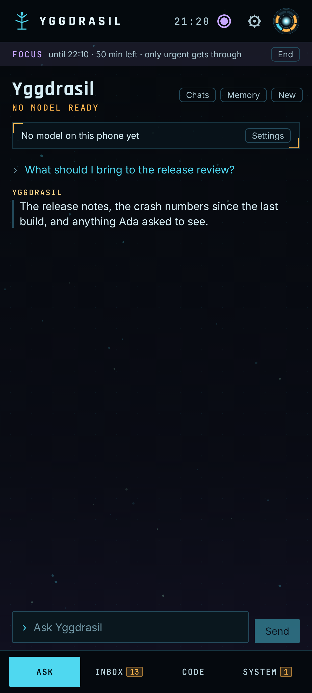 | 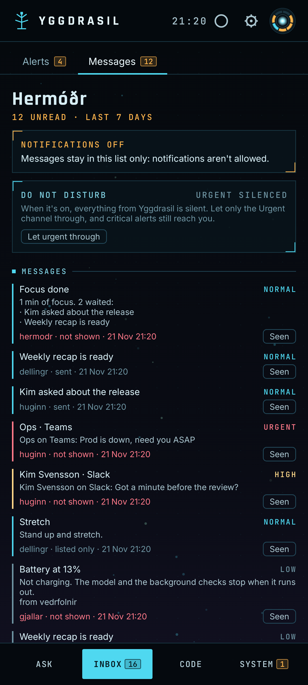 |

## Watching you: `ratatoskr/`

Ported from the desktop's `ratatoskr/you.go`: the parts' watchdog pointed
at your own rhythm. It runs with Veðrfölnir's 15-minute check.

| Pattern | When |
| --- | --- |
| A long run of meetings | 4 h or more back to back with no 15-minute gap. A focus block carries the run on; a *Break* event ends it |
| It's late | the phone in use past 23:00 (the desktop watches your coding sessions) |
| A full week | meetings fill 60% or more of the working hours (09–17) left this week |

- **How often:** at most one note per pattern per day (the full week: per
  week).
- **How it's sent:** quiet and low priority, held through meetings. Each
  note says what to do, e.g. "The pause at 11:00 is enough to stand up and
  get some water".
- **Privacy:** notes carry times only. Meeting titles and people never go
  into one.
- **Quiet hours:** nothing is sent then, except *It's late*, which is
  listed in Messages without a notification.
- **Settings:** switch it on or off, choose notification or listed only,
  and see what it sees right now.

## Health: `parts/`

Tap the **arc reactor** for Health, as on the dashboard
(`pages/dashboard/parts.vue`). Tap it again, or Back, to return.

- **One card per part:** Norn, Huginn, Dellingr, Hermóðr, Veðrfölnir,
  Sága, Claude, Gjallar and Ratatoskr.
  - **State:** up, needs a look, down, or not set up (Claude, and Sága
    without Mímir).
  - **Contents:** what the part does, what's wrong in one line, and a few
    facts, e.g. the model, memories, held messages, battery or the last
    sync.
- **Loops:** each part's timed loops, with when each last ran, judged by
  Ratatoskr's rule:
  - **Late:** past twice the loop's interval.
  - **Stalled:** past three intervals and a minute. A stalled or failed
    loop makes its part *need a look*.
  - **Where they come from:** the phone's parts run in-app rather than as
    servers, so `core/Loops.kt` records each round of the 15-minute check
    and the update check in place of `/health`.
- **Alerts:**
  - **On the cards:** each part lists the alerts it raised or that name
    it, with Seen, Snooze and Mute. An open critical alert makes its part
    *need a look*.
  - **Other alerts:** alerts no part claims are listed at the end.

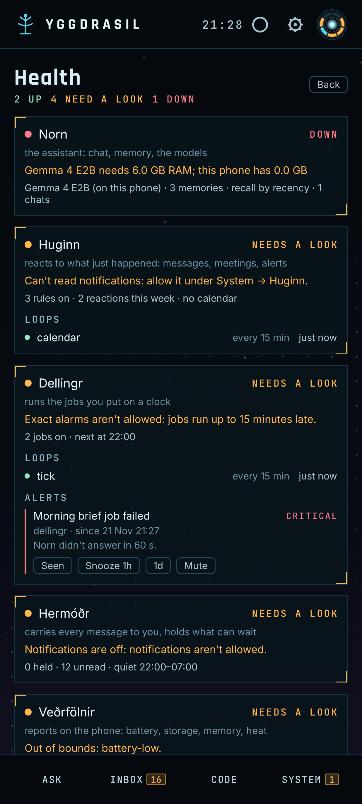

## Today: `today/`

Ported from the desktop's `norn/gap.go` and the dashboard's Today and day
ring. A card at the top of Ask, and over the apps on the home screen.

- **Day ring:**
  - **Outside:** today's meetings, one segment each, lit once they're over.
  - **Middle:** promises due by tomorrow.
  - **Inside:** what needs you (open alerts, unread messages, due promises).
    Its count is in the middle.
- **Meetings:** the one you're in (until when), or the next one and how
  soon.
- **The gap:**
  - **Free time:** when nothing holds you during the working day
    (09–17, Mon–Fri), it says how long you're free.
  - **What holds you:** meetings, *Break* and *Focus* events.
  - **One thing that fits**, with 5 minutes to spare:
    - a critical alert first (about 3 min),
    - then the oldest of a promise due by tomorrow (about 10 min) or a job
      that keeps failing (about 5 min).
  - **Buttons:** Done, the page for it, or *Focus until* the next meeting.

## Promises: `norn/Promises.kt`

Ported from the desktop's `norn/promises.go` and `promises_due.go`: what
you said you'd do for someone.

- **Where they're found:**
  - **Chat:** in what you write to Yggdrasil ("I told Kim I'll send the
    deck Friday").
  - **Shared text:** use Share → *Ygg: keep promises* on a mail or chat
    message you sent.
  - **By hand:** on the Promises page.
- **How they're read:** a quick word check skips most messages. The rest go
  to the on-device model; your words never leave the phone. With *Learn
  from what you say* off, chat isn't read for promises either.
- **The day:**
  - **From your words:** "Friday", "i morgon", "end of week", "24/11",
    "den 3 december", as on the desktop, with the desktop's tests.
  - **No day:** vague words ("soon", "next week") give none, and such a
    promise is never reminded.
- **Reminders:** once, from 08:00, on the working day before its day. A
  promise made too late for that is reminded on the day itself.
- **Inbox → Promises:**
  - **Open:** listed first, soonest day first, with Done, Drop, Day and No
    day.
  - **Closed:** listed with Reopen for 60 days.

| Promises | Today |
| --- | --- |
| 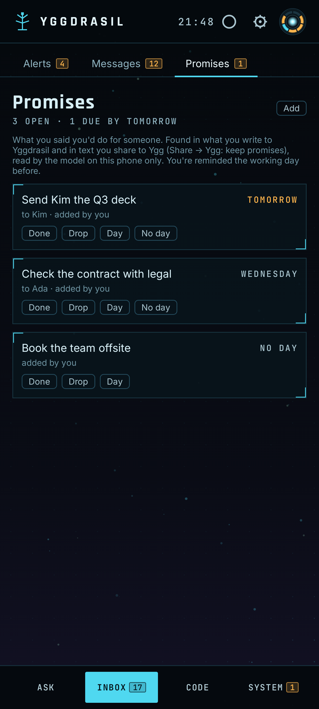 | 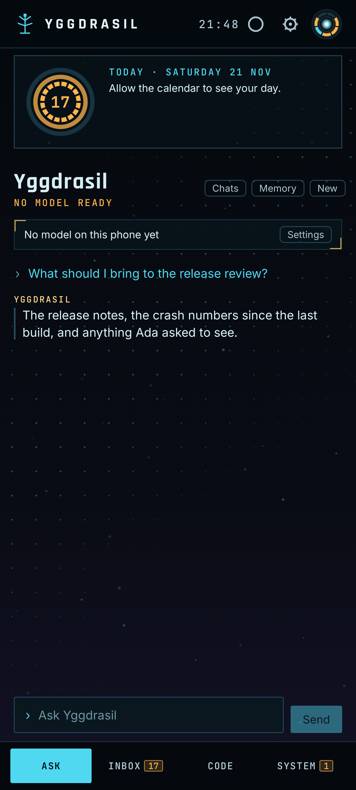 |

## Performance: `core/Perf.kt`

What is pulling what, as the dashboard's Performance page (`perf.vue`).
Open it from Health → *Performance*. It shows the last day or the last
week.

- **Right now:**
  - **Memory:** the app's share of RAM (PSS), Java and native heap.
  - **Models:** whether Gemma and the embedding model are in memory.
  - **CPU and network:** CPU time since the app started, and the app's
    network use since the phone started.
- **Who pulls on the model:** every call through the model router, by
  purpose and model.
  - **Purposes:** chat, learning facts, finding promises, swapping names,
    Huginn's briefs, Dellingr's jobs, and memory by meaning (embeddings).
  - **Figures:** calls, p50 and p95 time, tokens out, time the model was
    busy (with a bar for each purpose's share), and failures by kind
    (timeout, no model ready, …).
- **The parts' rounds:** each loop round (the 15-minute check, the update
  check, promise reminders), timed the same way.
- **Who moves the data:** bytes per part and kind: model downloads, app
  updates, Mímir sync.
- **Battery:** Android doesn't tell an app its own battery use. The time
  the model is busy is the closest measure, as the model is what drains it.

Steps are recorded off the main thread and kept for a week (`perf` in
`ygg.db`, v10). Recording never fails the thing it measures, and a chat
you stop isn't counted.

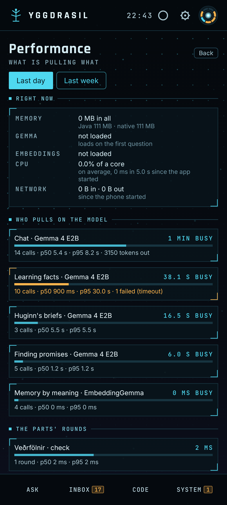

## Cloud sessions from the phone: the Claude bridge

The Code tab has a **This phone** section. You can start a Claude Code
cloud session for any repo and follow up on it with no computer on. Follow
ups also work on the desktop's cloud sessions while the desktop is away.

- **How:** Ygg's Claude bridge runs the real `claude` CLI with your
  subscription, on `127.0.0.1` with its own key, in **Ygg's own Linux**:
  Ubuntu's official base under proot shipped inside Ygg.
  - **Always on:** it runs under Ygg's own foreground service, and starts
    with the phone.
- **Setup:** Settings → Claude bridge.
  1. *Set up*: downloads about 30 MB, and takes about 1 GB once done.
  2. *Sign in to Claude*: the link and a code box, all in Ygg.
  3. *Always on*.
- **Elsewhere:** UserLAnd and Termux work too, with an install command to
  paste.
- **Also:** it makes the Claude provider work.

Details and the contract are in [docs/claude-bridge.md](docs/claude-bridge.md).

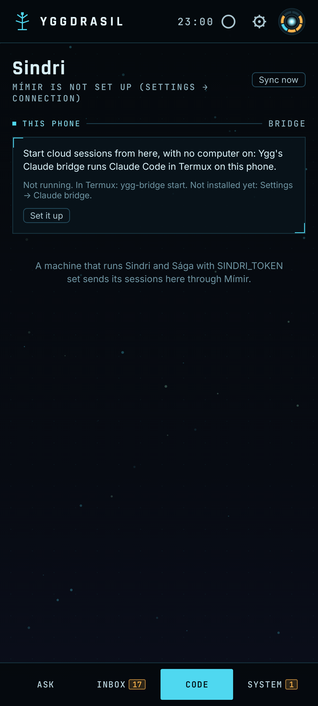

## Models: `llm/`

Parts never pick a model. They make an `LlmRequest` with:

- a **tier**: `SMALL` (names, classifying, one-liners) or `LARGE` (chat, briefs)
- a **privacy** level: `ON_DEVICE_ONLY` (the default) or `MAY_LEAVE_DEVICE`

`LlmRouter` goes through the providers in order and uses the first one that
is allowed, fits the tier, and is ready. When none can answer,
`NoProviderException` says why for each.

| Provider | Where | Status |
| --- | --- | --- |
| `LiteRtLmProvider` | on the phone, GPU with CPU fallback | working: Gemma 4 E2B (default), E4B |
| `ClaudeBridgeProvider` | Claude Code CLI on the phone (Ygg's own Linux), your subscription | working, through Ygg's Claude bridge |

`LiteRtLmProvider` keeps the last conversation open, so a follow-up
message doesn't feed the whole chat to the model again.

## Run it

1. Build and install:

   ```bash
   ./gradlew :app:installDebug
   ```

   Or install a signed APK from [Releases](https://github.com/SebbeJohansson/yggdrasil-mobile/releases).
   To publish one, push a tag like `v0.2.0` ([docs/releasing.md](docs/releasing.md)).

2. Open the app and tap **Download model**. Gemma 4 E2B is 2.6 GB, downloaded
   from Hugging Face and checked against its SHA-256. A stopped download
   continues where it left off, but only while the app is open.

   Or push a file you already have:

   ```bash
   adb push gemma-4-E2B-it.litertlm /sdcard/Android/data/io.github.sebbejohansson.yggdrasil/files/models/
   ```

## Develop

```bash
./gradlew :app:testDebugUnitTest   # router, Gjallar, Hermóðr, quiet hours, Sága
./gradlew :app:assembleDebug
```

Needs JDK 21 and the Android SDK with `platforms;android-37.2`.

## License

MIT, see [LICENSE](LICENSE). Bundled third-party parts (fonts, PRoot) keep their own licenses, in [docs/licenses](docs/licenses). Report security problems as [SECURITY.md](SECURITY.md) says.
