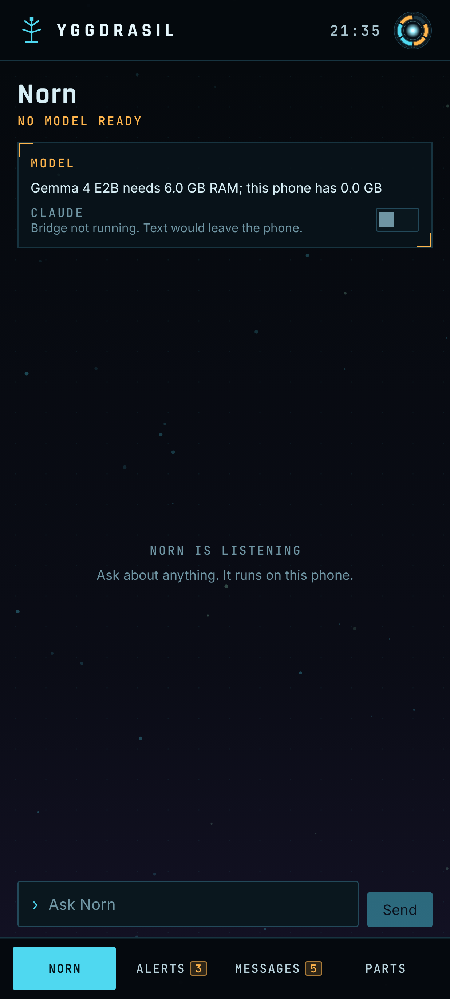
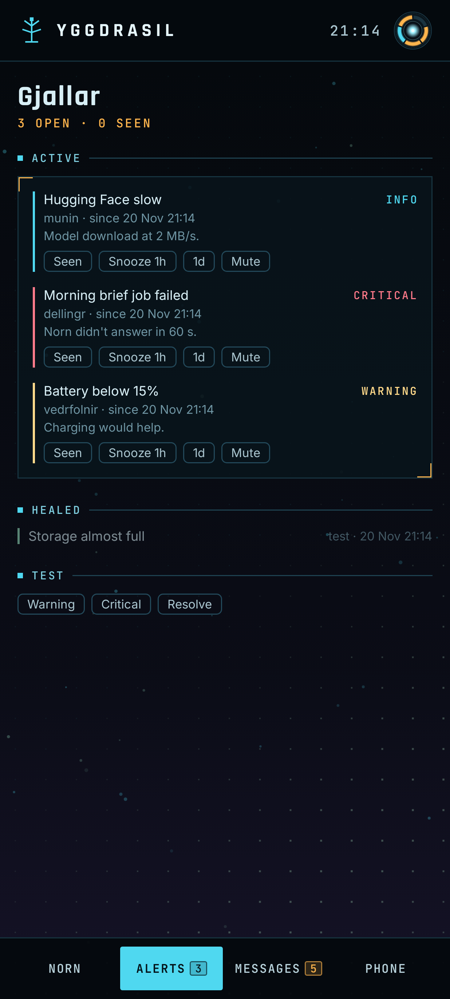
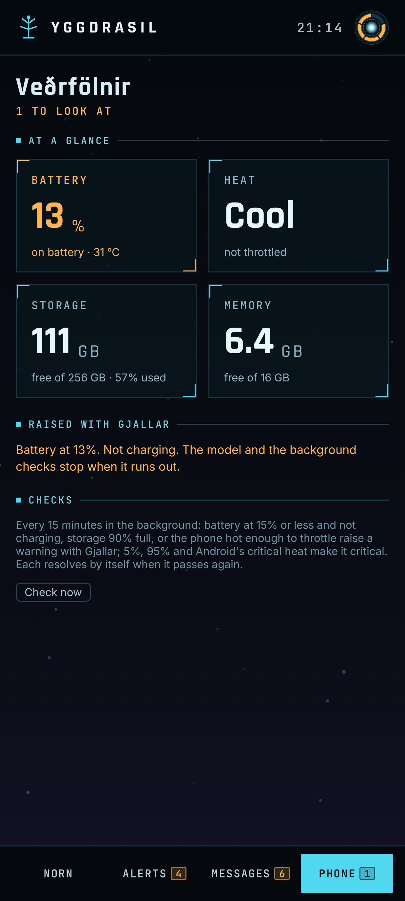

# Yggdrasil Mobile

[Yggdrasil](https://github.com/SebbeJohansson/yggdrasil), rebuilt as an
Android app that runs only on the phone. No server, no PC.

The model runs on the phone too: Gemma 4 through
[LiteRT-LM](https://github.com/google-ai-edge/LiteRT-LM). Claude can be
added as a second option, through Claude Code running on the phone
([docs/claude-bridge.md](docs/claude-bridge.md)).

## Look

The same HUD as [my-widget](https://github.com/SebbeJohansson/my-widget),
the desktop Yggdrasil's dashboard (`ui/`):

- **Ground:** near-black, with the dot grid and its rolling wave, rising
  specks, and a horizon glow in the colour of the time of day (`Backdrop`).
  When something new needs you, the next wave passes amber.
- **Colour:** cyan for what is normal, amber for what wants you.
- **Panels:** corner brackets, turning amber when they warn.
- **Fonts:** Rajdhani for headings and numbers, JetBrains Mono for labels,
  Inter for reading. All are bundled; their licences are in `docs/licenses`.
- **Top bar:** the arc reactor (`ArcReactor`), one segment per part. Tap it
  for the alerts.
- **Chat:** Norn's chat reads like the dashboard's ask panel. Your lines are
  cyan after `›`. Norn's lines sit under its name, with a line down the left.
- **Alerts:** the alert list keeps its severity line and its Seen, Snooze 1h,
  1d and Mute buttons.

| Norn | Alerts | Messages | Phone |
| --- | --- | --- | --- |
|  |  |  |  |

**Bifröst at night**, as on the desktop: after the working day (09:00–17:00,
Monday to Friday), when the app has gone 20 s untouched (5 min during
work hours), the ground fades into a slow aurora. It doesn't come while
you're typing or Norn is writing, and any touch sends it away. Today's
alerts and the troubled parts make it stormier: a calm day is slow and
green, a stormy one restless and violet. It's never red and shows no
numbers. When Android's animations are off it stands still.

| Calm | Stormy |
| --- | --- |
|  |  |

`ScreenshotTest` and `AuroraScreenshotTest` draw these on the JVM (Robolectric) into
`app/build/screenshots/`.

## Parts

The parts keep their Yggdrasil names and jobs. On the phone they are
packages in one app, not processes talking HTTP.

| Part | On the phone | Status |
| --- | --- | --- |
| **Norn** | chat, memory, the front desk | chat with Gemma 4 |
| **Gjallar** | alerts from every part, in one place | working |
| **Hermóðr** | every message to you, as Android notifications | working |
| **Dellingr** | scheduled jobs, on WorkManager | planned |
| **Huginn** | reacts to what just happened (incoming notifications) | planned |
| **Veðrfölnir** | the phone itself: battery, storage, memory, heat | working |

Sindri, Heimdall, Munin and Ratatoskr are desktop jobs and have no phone part.

## Alerts and messages

A part raises a problem with Gjallar, and tells you something through
Hermóðr. Both keep their state in `ygg.db` (SQLite).

**Gjallar** (`gjallar/`), with the same rules as Yggdrasil:

- The same source and key updates the open alert. A resolved alert opens
  again. An acknowledged one opens again when its severity goes up.
- How loud: `info` is listed in the app only. `warning` gets a quiet
  notification when it opens. `critical` gets an urgent one, again at most
  every 15 minutes while it keeps being raised.
- Muted alerts are listed, never pushed. Snoozed ones aren't pushed until
  the snooze ends (at most 30 days).
- Acknowledging, snoozing or resolving takes the notification back.
- Resolved alerts are kept for 30 days.

**Hermóðr** (`hermodr/`):

- There's one notification channel per priority (low, normal, high,
  urgent), so you set sound and Do Not Disturb for each in Android's
  settings.
- Quiet hours (default 22:00–07:00) hold everything but urgent messages.
  WorkManager sends what was held when they end.
- `hold` also waits while you're in a meeting. Meetings come from the
  phone's own calendars (`READ_CALENDAR`, asked for from the Messages tab,
  and read on the phone only). A meeting is timed, shown as busy, and not
  declined. Meetings less than 5 minutes apart count as one. Without
  calendar access nothing is ever held for a meeting.
- `push = false` lists a message in the app only.
- When notifications are off, the message is kept with the reason, and the
  Messages tab says why.
- Messages are kept for 7 days.

Notification buttons: **Seen** on messages, **Acknowledge** and **Snooze 1 h**
on alerts. The Alerts and Messages tabs have test buttons that run the
whole path on the phone.

## The phone: `vedrfolnir/`

Veðrfölnir watches the phone as the desktop part watches the machine. One
problem is one alert with Gjallar (source `vedrfolnir`), and the alert
resolves by itself when its check passes again. It fixes nothing.

| Check | Warning | Critical |
| --- | --- | --- |
| `battery-low` | 15% or less and not charging | 5% |
| `storage` | 90% full | 95% |
| `heat` | Android's thermal status is severe, or the battery is 45 °C or more | Android's thermal status is critical |

It checks when the app starts, and every 15 minutes through WorkManager,
which is Android's shortest period. The Phone tab shows the readouts live,
every 5 s while it's open, and has a segment on the arc reactor. A reading
the phone doesn't give, such as a battery level, raises nothing.

## Models: `llm/`

Parts never pick a model. They make an `LlmRequest` with:

- a **tier**: `SMALL` (names, classifying, one-liners) or `LARGE` (chat, briefs)
- a **privacy** level: `ON_DEVICE_ONLY` (the default) or `MAY_LEAVE_DEVICE`

`LlmRouter` goes through the providers in order and uses the first one that
is allowed, fits the tier, and is ready. When none can answer,
`NoProviderException` says why for each.

| Provider | Where | Status |
| --- | --- | --- |
| `LiteRtLmProvider` | on the phone, GPU with CPU fallback | working: Gemma 4 E2B (default), E4B |
| `ClaudeBridgeProvider` | Claude Code CLI on the phone, your subscription | app side done; bridge not written |

`LiteRtLmProvider` keeps the last conversation open, so a follow-up
message doesn't feed the whole chat to the model again.

## Run it

1. Build and install:

   ```bash
   ./gradlew :app:installDebug
   ```

   Or install a signed APK from [Releases](https://github.com/SebbeJohansson/yggdrasil-mobile/releases).
   To publish one, push a tag like `v0.2.0` ([docs/releasing.md](docs/releasing.md)).

2. Open the app and tap **Download model**. Gemma 4 E2B is 2.6 GB, downloaded
   from Hugging Face and checked against its SHA-256. A stopped download
   continues where it left off, but only while the app is open.

   Or push a file you already have:

   ```bash
   adb push gemma-4-E2B-it.litertlm /sdcard/Android/data/io.github.sebbejohansson.yggdrasil/files/models/
   ```

## Develop

```bash
./gradlew :app:testDebugUnitTest   # router, Gjallar, Hermóðr, quiet hours
./gradlew :app:assembleDebug
```

Needs JDK 21 and the Android SDK with `platforms;android-37.2`.
